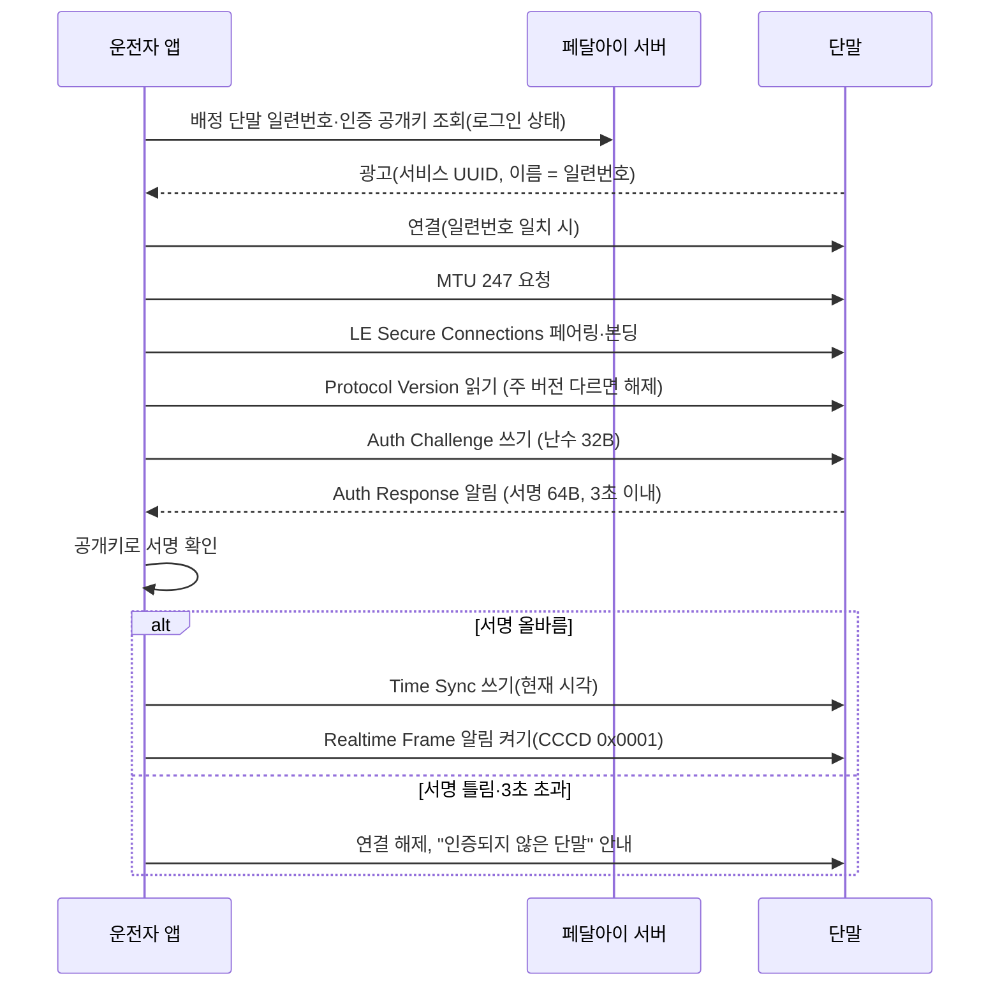
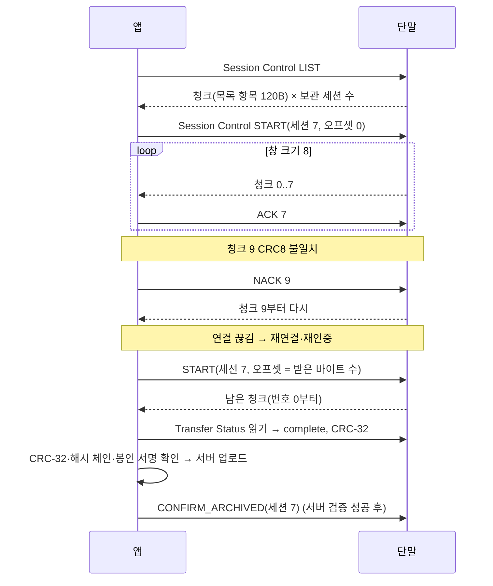

# 페달아이 단말 BLE 통신 규격 v1.0 (초안)

| 항목 | 내용 |
| --- | --- |
| 문서 상태 | 초안(2026-11-17). 하드웨어 업체 검토 후 확정 |
| 대상 | 단말 펌웨어 개발자, 운전자 앱(Android) 개발자 |
| 기준 구현 | `pedaleye-app/lib/core/ble/ble_protocol.dart` |
| 시험 벡터 | `pedaleye-app/test/fixtures/ble_test_vectors.json` (생성기: `pedaleye-app/tool/generate_ble_vectors.mjs`) |

이 문서의 예시 바이트는 모두 시험 벡터 파일과 같고, 앱 테스트(`test/core/ble/ble_protocol_test.dart`)가 바이트 단위로 확인한다. 펌웨어도 같은 벡터로 시험해야 한다.

---

## 1. 개요

- 단말(페달아이)은 BLE 주변기기(Peripheral, GATT 서버), 운전자 앱은 중앙기기(Central, GATT 클라이언트)다.
- 단말 하나는 한 번에 앱 하나와만 연결한다.
- 모든 정수는 **Little-Endian**, 문자열은 **UTF-8**이다.
- 블루투스 코어 사양 **5.0 이상**과 **LE Secure Connections**를 지원해야 한다.

### 1.1 보안 목표

| 위협 | 대응 |
| --- | --- |
| 무선 도청·패킷 변조 | LE Secure Connections 페어링(암호화 링크) 필수 |
| 남의 단말·가짜 단말 연결 | 단말 인증: 앱 난수에 단말 Ed25519 서명 → 서버에 등록된 공개키로 확인 |
| 사고 기록 위조·변조 | 64바이트 패킷 SHA-256 해시 체인 + 세션 봉인 서명(단말 개인키) → 서버가 끝까지 검증 |
| 앱(운전자)에 의한 기록 조작 | 앱은 기록을 만들 수 없다. 봉인 서명은 단말만 만들 수 있다 |

> 남는 위험: Just Works 페어링은 중간자(MITM) 공격을 막지 못하고, 인증 응답을 실제 단말에 중계하는 공격도 막지 못한다. 이 경우에도 **사고 기록은 단말이 서명·체인으로 봉인하므로 위조할 수 없다**. 실시간 프레임은 화면 표시용이며 증거로 쓰지 않는다.

---

## 2. 광고(Advertising)

| 위치 | 내용 |
| --- | --- |
| 광고 패킷 | Flags, **Security & Auth 서비스 UUID(128비트)** `50454441-4c45-5945-494f-543100020000` |
| 스캔 응답 | Complete Local Name = 단말 일련번호(예: `PE-2026-000001`) |
| 광고 간격 | 미연결 시 100~200ms(빠른 발견), 30초 후 1~2초(절전) |

앱은 서비스 UUID로 걸러 찾고, 이름이 **자기 배정 단말의 일련번호와 같을 때만** 연결한다.

---

## 3. GATT 구성

### 3.1 UUID 체계

`50454441-4C45-5945-494F-5431SSSSCCCC` (앞부분은 ASCII "PEDALEYEIOT1")
- `SSSS`: 서비스 번호(0001~0004), `CCCC`: 특성 번호(서비스 자신은 0000)

### 3.2 서비스·특성 표

보안 열: **Open** = 암호화 없이 허용, **Enc** = 암호화(페어링된) 링크 필요, **Auth** = Enc + 이번 연결에서 인증 응답 완료.
요건을 못 갖춘 접근에는 ATT 오류 `0x05 Insufficient Authentication`(Open/Enc 위반) 또는 `0x80 NOT_AUTHENTICATED`(Auth 위반)를 돌려준다.

| UUID 끝 8자리 | 이름 | 속성 | 보안 | 크기 | 형식 |
| --- | --- | --- | --- | --- | --- |
| **0001 0000** | **Device Info 서비스** | | | | |
| 0001 0001 | Protocol Version | Read | Open | 2 | u16, `0x0100` = v1.0 (상위 바이트 = 주 버전) |
| 0001 0002 | Serial Number | Read | Open | ≤16 | UTF-8, 예 `PE-2026-000001` |
| 0001 0003 | Hardware Rev | Read | Open | ≤16 | UTF-8, 예 `v1.0` |
| 0001 0004 | Firmware Version | Read | Open | ≤16 | UTF-8, 예 `1.0.0` |
| 0001 0005 | Device Status | Read/Notify | Enc | 4 | 배터리 % u8 ‖ 플래그 u8 ‖ 보관 세션 수 u16 |
| **0002 0000** | **Security & Auth 서비스** | | | | |
| 0002 0001 | Auth Challenge | Write | Enc | 32 | 앱 난수 |
| 0002 0002 | Auth Response | Read/Notify | Enc | 64 | Ed25519 서명(R ‖ S, RFC 8032) |
| 0002 0003 | Auth Status | Read | Enc | 1 | 0 미인증 · 1 응답 완료 · 2 오류 |
| **0003 0000** | **Pedal Telemetry 서비스** | | | | |
| 0003 0001 | Realtime Frame | Notify | Auth | 64 | 64바이트 패킷(4장) |
| 0003 0002 | Calibration | Read/Write | Auth | 8 | u16 ×4: 가속 최소·최대, 제동 최소·최대(0.01mm) |
| 0003 0003 | Time Sync | Write | Auth | 8 | u64 UTC epoch ms |
| **0004 0000** | **Forensic Session 서비스** | | | | |
| 0004 0001 | Session Control | Write | Auth | 12 | 5.2절 |
| 0004 0002 | Session Data Chunk | Notify | Auth | ≤240 | 5.3절 |
| 0004 0003 | Transfer Status | Read/Write | Auth | 읽기 18 / 쓰기 3 | 5.4절 |

Device Status 플래그: bit0 센서 정상, bit1 시각 동기화됨, bit2 저장 공간 가득 참, 나머지 0.
예: `57030200` = 배터리 87%, 센서 정상·시각 동기화, 보관 세션 2건.

### 3.3 연결 파라미터

| 항목 | 값 |
| --- | --- |
| ATT MTU | 연결 직후 앱이 **247** 요청. 64바이트 알림을 위해 **최소 67** 필요. 67 미만이면 앱은 "지원하지 않는 휴대폰" 안내 후 연결 해제 |
| 연결 간격 | 15~30ms (실시간 20Hz) / 사고 기록 전송 중 7.5~15ms 권장 |
| PHY | 1M 필수, 2M 지원 권장 |
| 감독 타임아웃 | 4초 |
| 처리량 목표 | 실시간 64B×20Hz ≈ 1.3KB/s, 기록 전송 ≥ 20KB/s(60초 50Hz 기록 ≈ 192KB를 10초 안에) |

---

## 4. 연결·인증 절차

### 4.1 단말 인증 메시지

서명 대상 **80바이트** = 도메인 태그 32 ‖ 일련번호 16 ‖ 앱 난수 32

| 부분 | 값 |
| --- | --- |
| 도메인 태그 | ASCII `PEDAL_EYE_DEVICE_ATTESTATION_V1`(31바이트) + `0x00` 1바이트 |
| 일련번호 | UTF-8, 16바이트에 맞춰 남는 자리 `0x00` |
| 앱 난수 | 앱이 암호학적 난수 생성기로 만든 32바이트(연결마다 새로) |

서명: 단말 Ed25519 개인키로 RFC 8032 순수 Ed25519 서명(사전 해시 없음), 결과 64바이트 R ‖ S.

규칙
- 단말은 Auth Challenge를 받으면 **3초 안에** Auth Response를 알림으로 보내고 Auth Status를 1로 바꾼다.
- 한 연결에서 Challenge는 최대 3회(그 이상은 `0x83 BUSY`)다.
- Auth Status가 1이 되기 전 Telemetry·Forensic 서비스 접근은 `0x80 NOT_AUTHENTICATED`로 거부한다.
- 연결이 끊기면 인증 상태는 초기화한다(본딩 정보는 유지).
- 개인키는 보안 요소(Secure Element)나 읽기 보호된 플래시에 두고, **어떤 특성으로도 읽을 수 없어야** 한다.
- 공개키(32바이트)는 출하 정보로 제공하며, 페달아이 웹 단말 등록 화면에서 서버에 등록한다.

시험 벡터 `attestation`: 시험 키 `publicKey = 046e71ee…125656`, 난수·메시지·서명, 1비트 바꾼 서명(거부돼야 함).

---

## 5. 데이터 형식

### 5.1 64바이트 패킷(기존 .pel 레코드와 같음)

| 오프셋 | 크기 | 이름 | 단위·형식 |
| --- | --- | --- | --- |
| 0 | 4 | Sequence_ID | u32 |
| 4 | 8 | Timestamp_UTC | u64 epoch ms |
| 12 | 2 | Accel_Distance | u16, 0.01mm |
| 14 | 1 | Accel_Percentage | u8, 0~100 |
| 15 | 2 | Brake_Distance | u16, 0.01mm |
| 17 | 1 | Brake_Percentage | u8, 0~100 |
| 18 | 1 | Both_Pedal_Flag | u8, 0/1 |
| 19 | 1 | 예약 | 0 |
| 20 | 4 | GPS_Latitude | i32, 1e-7° |
| 24 | 4 | GPS_Longitude | i32, 1e-7° |
| 28 | 2 | GPS_Speed | u16, 0.1km/h |
| 30 | 2 | 예약 | 0 |
| 32 | 32 | Prev_Record_Hash | 직전 패킷의 SHA-256 |

해시 체인
- `H(-1) = SHA-256("PEDAL_EYE_GENESIS_" + 일련번호 + "_" + 첫 패킷 시각(ms, 10진수))`
- 패킷 i의 [32..63] = `H(i-1)`, `H(i) = SHA-256(패킷 i 64바이트 전체)`
- **단말은 서버의 단말 ID를 모르므로 시작값에 일련번호를 쓴다**(서버는 단말 일련번호로 검증한다. 7절 참고).

**실시간 프레임**: 알림을 켤 때마다 Sequence_ID를 0부터 새로 매기고 체인을 새로 시작한다(그때 첫 프레임 시각으로 시작값 계산). 앱은 번호 건너뜀(무선 유실)을 세고, 같은 체인 안에서 Prev_Record_Hash를 확인한다. 실시간 프레임은 화면 표시용이다.

시험 벡터 `realtime`: 가속 100%·제동 100%·양발 동시 3장과 각 해시.

### 5.2 Session Control 쓰기(12바이트)

| 오프셋 | 크기 | 이름 |
| --- | --- | --- |
| 0 | 1 | 명령 |
| 1 | 4 | 세션 ID (u32) |
| 5 | 4 | 바이트 오프셋 (u32) |
| 9 | 3 | 예약(0) |

| 명령 | 이름 | 동작 |
| --- | --- | --- |
| `0x01` | START | 세션 ID의 .pel을 바이트 오프셋부터 전송. 청크 번호는 0부터 |
| `0x02` | PAUSE | 전송 멈춤(상태 paused). 다시 START(오프셋 지정)로 재개 |
| `0x03` | CANCEL | 전송 중단, 상태 idle |
| `0x04` | LIST | 보관 세션 목록을 청크로 전송(세션 ID 칸 = 시작 순번, 보통 0) |
| `0x05` | CONFIRM_ARCHIVED | 서버 검증 완료 통지. 이후 단말이 저장 공간이 필요할 때 이 세션을 지워도 된다 |

**단말은 CONFIRM_ARCHIVED를 받기 전에는 세션을 지우지 않는다.** 저장 공간이 가득 차면 새 기록보다 확인 안 된 기록을 우선 보존하고 Device Status의 '가득 참'을 켠다(가장 오래된 확인 완료 기록부터 지움).

예(세션 7): START 처음부터 `010700000000000000000000`, 이어받기(오프셋 236) `0107000000ec000000000000`, LIST `040000000000000000000000`, CONFIRM_ARCHIVED `050700000000000000000000`. ACK 1 = `100100`, NACK 1 = `110100`.

### 5.3 Session Data Chunk 알림(4 + N바이트, N ≤ 236)

| 오프셋 | 크기 | 이름 |
| --- | --- | --- |
| 0 | 2 | Chunk_Seq (u16, START·LIST마다 0부터) |
| 2 | 1 | Payload_Size N |
| 3 | 1 | CRC8(페이로드) — 다항식 0x07, 초기값 0x00, 반사 없음 |
| 4 | N | 페이로드 |

- START: 페이로드는 .pel 파일의 연속 바이트(오프셋부터). 레코드 경계와 무관하다.
- LIST: 청크 하나에 목록 항목 하나(120바이트). 항목이 없으면 Transfer Status만 complete로 바뀐다.
- 마지막 청크를 보낸 뒤 Transfer Status를 complete로 바꾸고 알림이 아닌 읽기로 확인하게 한다.

### 5.4 Transfer Status

읽기(18바이트)

| 오프셋 | 크기 | 이름 | 값 |
| --- | --- | --- | --- |
| 0 | 1 | 상태 | 0 idle · 1 listing · 2 sending · 3 paused · 4 complete · 5 error |
| 1 | 1 | 오류 코드 | 6절, 정상 0 |
| 2 | 4 | 세션 ID | |
| 6 | 4 | 전체 바이트 | .pel 크기(= 64×N + 32) |
| 10 | 4 | 보낸 바이트 | 오프셋 포함 누적 |
| 14 | 4 | CRC-32 | 전체 파일의 IEEE 802.3 CRC-32(complete일 때) |

쓰기(3바이트): `0x10` ACK(이 번호까지 정상 수신) 또는 `0x11` NACK(이 번호부터 다시) ‖ Chunk_Seq u16.

### 5.5 흐름 제어·재전송·이어받기

- 창 크기: 단말은 ACK 없이 **최대 8청크**까지 보낸다. 앱은 4청크마다 또는 마지막 청크에서 ACK를 보낸다.
- NACK: 단말은 그 번호의 청크부터 다시 보낸다(go-back-N).
- 무응답: 앱은 2초 동안 청크가 없으면 다음 기대 번호로 NACK, 3회 실패하면 START(받은 바이트 수)로 다시 시작한다.
- 이어받기 오프셋은 앱이 정상 수신해 저장한 바이트 수이며, 단말은 0 ≤ 오프셋 < 전체 크기를 확인한다(위반 시 `0x82`).

### 5.6 세션 목록 항목(120바이트)과 봉인 서명

| 오프셋 | 크기 | 이름 |
| --- | --- | --- |
| 0 | 4 | 세션 ID u32 |
| 4 | 1 | 트리거: 0 shock · 1 sudden_accel · 2 manual · 3 periodic |
| 5 | 1 | 플래그: bit0 CONFIRM_ARCHIVED 받음 |
| 6 | 2 | 예약 |
| 8 | 8 | 시작 시각 u64 ms(첫 패킷) |
| 16 | 4 | 레코드 수 N |
| 20 | 4 | 바이트 길이(= 64N + 32) |
| 24 | 32 | 최종 체인 해시 H(N-1) |
| 56 | 64 | 봉인 서명 |

봉인 서명 대상 **96바이트** = 도메인 `PEDAL_EYE_SESSION_SEAL_V1`(32바이트로 0x00 채움) ‖ 일련번호 16 ‖ 세션 ID u32 ‖ 시작 시각 u64 ‖ 레코드 수 u32 ‖ 최종 해시 32.
단말은 세션 기록을 닫을 때(트리거 후 60초 동결 완료) 한 번 서명해 저장한다. 앱·서버는 등록된 공개키로 확인하므로 **단말 밖에서 기록을 만들거나 고칠 수 없다.**

---

## 6. 오류 코드

ATT 응용 오류와 Transfer Status 오류 칸에 같이 쓴다.

| 코드 | 이름 | 의미 |
| --- | --- | --- |
| `0x05` | (표준) Insufficient Authentication | 암호화되지 않은 링크 |
| `0x80` | NOT_AUTHENTICATED | 이번 연결에서 인증 응답 전 |
| `0x81` | INVALID_SESSION | 없는 세션 ID |
| `0x82` | INVALID_OFFSET | 오프셋 범위 오류 |
| `0x83` | BUSY | 다른 전송 중·인증 시도 초과 |
| `0x84` | STORAGE_ERROR | 저장소 읽기 오류 |
| `0x85` | INVALID_CALIBRATION | 보정 범위 오류(최대 − 최소 < 500, 즉 5mm) |
| `0x86` | UNSUPPORTED_VERSION | 지원하지 않는 규격 버전 |

---

## 7. 버전·호환·서버 연동

- 주 버전(상위 바이트)이 다르면 앱은 연결하지 않고 "앱 또는 단말 업데이트 필요"를 안내한다. 부 버전 차이는 호환(새 특성은 선택)이다.
- 특성 추가는 부 버전, 기존 형식 변경은 주 버전을 올린다.
- 서버 연동: 단말 인증 공개키는 웹 단말 관리에서 등록한다(작업 BLE 2). 서버의 사고 기록 검증은 BLE 단말 세션의 시작 해시를 **일련번호**로 계산하고 봉인 서명을 확인하도록 확장한다(작업 BLE 4).

## 8. 펌웨어 체크리스트

- [ ] 시험 벡터의 인증 메시지·서명, 패킷·해시, 청크·CRC, 목록 항목·봉인 서명을 그대로 재현한다
- [ ] 암호화되지 않은 링크·인증 전 접근 거부(0x05/0x80)
- [ ] MTU 247 수락, 67 미만 연결에서 실시간 알림을 보내지 않는다
- [ ] 개인키를 어떤 경로로도 내보내지 않는다(디버그 포트 잠금 포함)
- [ ] CONFIRM_ARCHIVED 전에는 세션을 지우지 않는다
- [ ] 전원 차단 중에도 동결된 사고 기록이 손상되지 않는다(쓰기 완료 후 서명·목록 반영)
